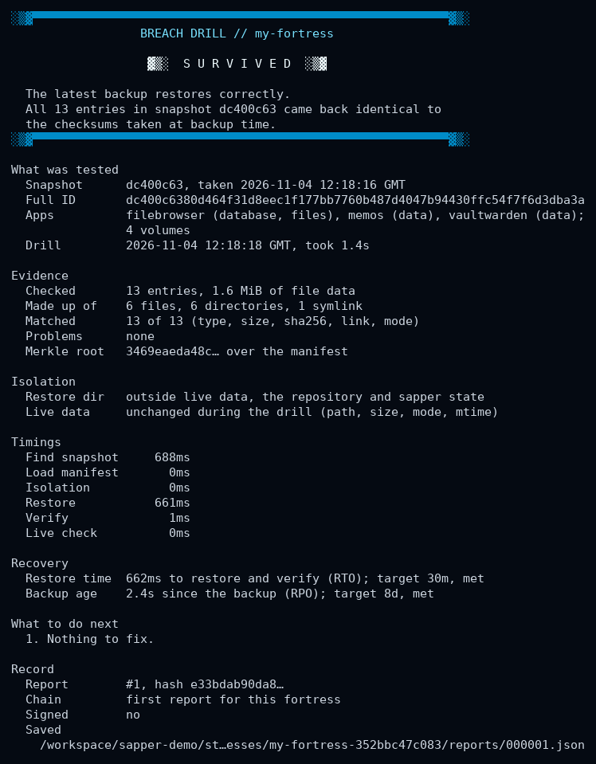
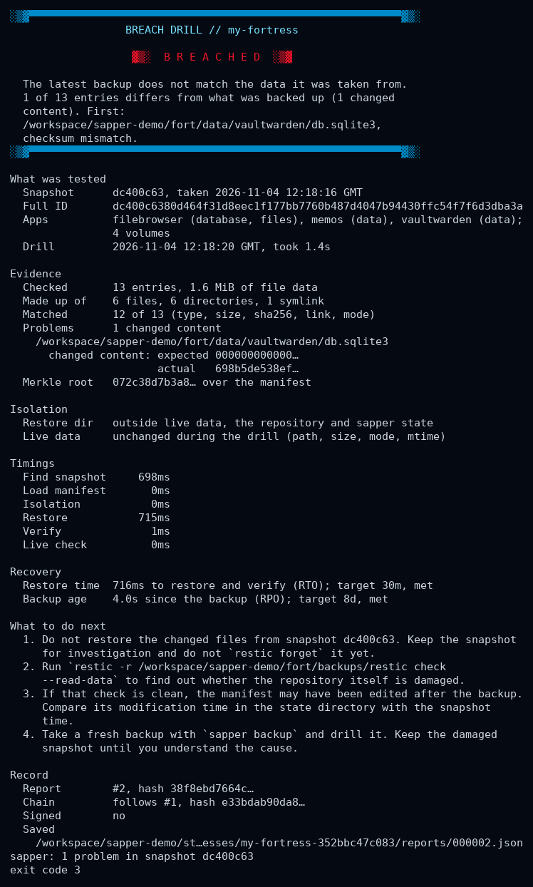
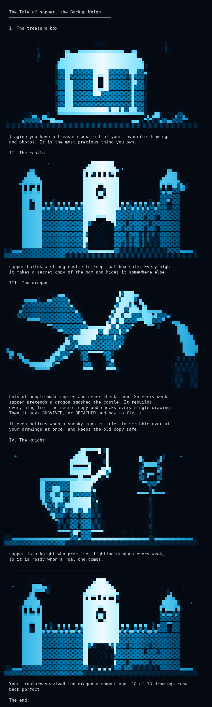

# sapper

sapper runs self-hosted apps from one blueprint file, backs them up with restic,
and regularly proves the backups by restoring them into a throwaway directory
and checking every file. It prints SURVIVED or BREACHED, or NO VERDICT when the
drill could not run (no snapshot, no manifest, or a failed restore).

Drills only ever write to a fresh temporary directory. sapper refuses to run a
drill whose restore directory overlaps a data volume, the repository or its own
state.

## Install

Requires Go 1.26+ to build, and [restic](https://restic.net) at run time.
docker or podman with the compose plugin is needed only for `sapper build --up`.

    go build -o sapper ./cmd/sapper

## Quick start

    sapper init                         # writes fortress.blueprint
    sapper validate
    sapper build --dry-run              # prints .sapper/docker-compose.yml and friends
    sapper build --up                   # Linux only: docker compose up -d
    export SAPPER_RESTIC_PASSWORD=...   # or --password-file / --password-stdin
    sapper backup
    sapper breach
    sapper status

Apps in the built-in catalogue: `vaultwarden`, `filebrowser`, `memos`.

## Commands

| command    | does |
|------------|------|
| `init`     | write an example blueprint (`--yes` to overwrite) |
| `validate` | check the blueprint |
| `build`    | render `.sapper/` (`--dry-run`, `--up`, `--runtime docker\|podman`) |
| `preflight` | check volumes, repository, password, locks, free space, and whether this host can delete the backups |
| `backup`   | restic backup of every volume plus a checksum manifest, kept locally and in the repository (`--dry-run`, `--force`, `--sign-key`) |
| `breach`   | restore latest snapshot to a temp dir, verify it and print an evidence report (`--brief`, `--strict`, `--sign-key`, `--keep`, `--temp-dir`, `--snapshot`, `--sample`, `--pub-key`) |
| `reports`  | list saved drill reports; `reports show [n]` (`--markdown`, `--brief`); `reports verify` (`--pub-key`, repeatable; `--revoked`; `--head`) |
| `keygen`   | create an ed25519 key pair for signing reports (`--out`) |
| `status`   | boot art, fortress, last backup, last drill |
| `completion` | shell completion for bash, zsh, fish, powershell |

Global flags: `-f/--blueprint`, `--json`, `-q/--quiet`, `-v/--verbose` (log
every restic/docker/podman command to stderr), `--no-color`, `--plain`.
Results go to stdout, progress and logs to stderr.

## Exit codes

| code | meaning |
|------|---------|
| 0 | success; for `breach`, the drill survived |
| 1 | operation failed |
| 2 | usage error: bad flags, arguments or blueprint, missing password |
| 3 | `breach` ran and found damaged, missing or unexpected files; `reports verify` found an edited, missing or reordered report |
| 4 | `breach` could not reach a verdict (no snapshot, no manifest, restore failed) |
| 5 | restic, docker or podman not installed |
| 6 | `backup` refused because live data looks damaged (empty or shrunk volume, mass encryption); `--force` overrides |
| 7 | `breach --strict` only: the drill survived but missed its RTO or RPO target |

## Drill reports

Every `sapper breach` ends with an evidence report. The verdict and the reason for
it come first, then the detail:

    ░▒▓▀▀▀▀▀▀▀▀▀▀▀▀▀▀▀▀▀▀▀▀▀▀▀▀▀▀▀▀▀▀▀▀▀▀▀▀▀▀▀▀▀▀▀▀▀▀▀▀▀▀▀▀▀▀▀▀▀▀▓▒░
                      BREACH DRILL // my-fortress

                       ▓▒░  S U R V I V E D  ░▒▓

      The latest backup restores correctly.
      All 11 entries in snapshot 523b76e9 came back identical to
      the checksums taken at backup time.
    ░▒▓▀▀▀▀▀▀▀▀▀▀▀▀▀▀▀▀▀▀▀▀▀▀▀▀▀▀▀▀▀▀▀▀▀▀▀▀▀▀▀▀▀▀▀▀▀▀▀▀▀▀▀▀▀▀▀▀▀▀▓▒░

    What was tested       snapshot (short and full ID, when it was taken), apps and volumes
    Evidence              entries checked and matched, bytes, each problem with expected
                          and actual values, Merkle root over the manifest
    Isolation             restore directory checked outside live data; live data
                          compared before and after the drill
    Timings               each phase
    Recovery              restore time (RTO) and backup age (RPO) against targets
    What to do next       a concrete step for each kind of problem
    Record                report number, hash, previous hash, signature

`--brief` prints one line for cron mail; `--json` prints the structured report;
`--plain` drops the art frame. Output never exceeds 80 columns.

Reports are saved in the state directory as `reports/NNNNNN.json` and a Markdown
copy, `NNNNNN.md`, to paste into a ticket. They contain host paths of your data
and the repository location (passwords in URLs are replaced with `***`); read one
before sharing it.

Each report stores the sha256 of the one before it. `sapper reports verify`
recomputes the chain and reports any edited, removed or reordered report. Two
things the chain cannot do on its own: notice that the newest reports were
deleted, and stop someone who can write the state directory from rebuilding it.
For those, sign reports with a key kept away from the state directory and record
the latest hash elsewhere:

    sapper keygen                                   # ~/.config/sapper/drill.key and .pub
    sapper breach --sign-key ~/.config/sapper/drill.key
    sapper reports verify --pub-key drill.key.pub --head 4be0c1d2e3f4

### Recovery targets

Optional. Each drill measures restore-and-verify time (RTO) and the age of the
backup it tested (RPO), and compares them with:

    targets:
      rto: 30m    # Go duration, or whole days such as 7d; at most a year
      rpo: 26h

A missed target is reported in the headline and the next steps. It does not
change the exit code: the data still restored correctly.

## Protecting the backups themselves

Most famous backup losses were not restic-style corruption. Backups had
silently stopped, or someone deleted them, or the data was already broken when
it was backed up. [docs/SIMULATIONS.md](docs/SIMULATIONS.md) has 26 such
scenarios and what sapper does about each. In short:

- **Before backing up**, sapper compares live data with the last backup. It
  refuses (exit 6) when a volume is empty (often an unmounted disk), has lost
  more than half its files or bytes, or when most files changed and the changed
  files look encrypted. Check what happened, then `sapper backup --force` if it
  was intended.
- **Retention never removes the newest snapshot that passed a drill**, so a run
  of bad backups cannot push out the last good one.
- **The manifest is also stored in the repository** (as a snapshot tagged
  `sapper-manifest`). A drill from a new machine, after the original host is
  gone, uses it. Sign it with `sapper backup --sign-key` and require the
  signature with `sapper breach --pub-key`.
- **Drill older snapshots too**: `sapper breach --sample 3` restores three random
  older snapshots as well. `--snapshot <id>` drills one.
- **Keep one copy this host cannot delete.** Ransomware running as your user can
  delete a local or sftp repository. Use
  [rest-server](https://github.com/restic/rest-server) with `--append-only`, or
  S3/B2 object lock, and run `forget`/`prune` from another machine.
  `sapper preflight` reports when the repository is deletable from here.
- Drills restore with `--no-cache`, so restic's local cache cannot hide damage in
  the repository.

## Secrets

The repository password is read from `--password-file`, `--password-stdin`, or
the environment variable named by `backup.password_env`. It is never accepted as
a flag value, never written by sapper, and never shown in `-v` command logs.

## Where things live

- `.sapper/` next to the blueprint: rendered compose file, `restic.env`, backup
  path list, drill cron line. Safe to delete; `sapper build` recreates it.
- Per-user state (manifests, last backup, last drill, drill reports):
  - Linux: `$XDG_STATE_HOME/sapper`, default `~/.local/state/sapper`
  - macOS: `~/Library/Application Support/sapper`
  - Windows: `%LOCALAPPDATA%\sapper`
  - override with `SAPPER_STATE_DIR`

## Platforms

| | Linux | macOS | Windows |
|---|---|---|---|
| init, validate, build (render), backup, breach, status | yes | yes | yes |
| build --up (host the fortress) | yes | no, says to run on Linux | no, says to run on Linux |

Colour follows [NO_COLOR](https://no-color.org), `--no-color` and `--plain`,
and is off when stdout is not a terminal. On Windows, ANSI output is enabled
through the console's virtual terminal mode and falls back to plain text when
that is unavailable. The boot animation runs only on an interactive colour
terminal; press Enter, pass `--no-anim` or set `SAPPER_NO_ANIM=1` to skip it.

## Telemetry

None. sapper makes no network connections of its own; restic and the container
runtime connect only where your blueprint points them.

## Limitations

See [DESIGN.md](DESIGN.md#limitations).

## Licence

Apache-2.0. See [LICENSE](LICENSE).

## Easter eggs

`sapper tale` is not in the main help. It tells what sapper does as a bedtime
story: the treasure box, the castle, the dragon and the warden. On an interactive
colour terminal of at least 78x30 it plays as a 38-second half-block cutscene on the
alternate screen (any key skips to the end; the terminal is restored on exit or
Ctrl-C), ending the way your last drill did. Elsewhere it prints the pictures.
If a blueprint and a drill report exist, the story ends with what happened to
your own data, for example "Your treasure survived the dragon 2 days ago. 13 of
13 drawings came back perfect." It honours `--plain` (ASCII pictures),
`--no-anim` and `SAPPER_NO_ANIM`, and refuses `--json`.

The pictures are drawn by `scripts/taleart.py` and the recording is made with
`scripts/taletape.py`; see [docs/ART.md](docs/ART.md) for the art rules; individual panels are in
[docs/img/tale/](docs/img/tale/).

## Verifying a release

Release binaries are built reproducibly (`CGO_ENABLED=0`, `-trimpath`,
`-buildid=`, `SOURCE_DATE_EPOCH` from the tagged commit), listed in `SHA256SUMS`,
signed with cosign keyless signing, and come with SLSA level 3 provenance and
CycloneDX SBOMs. Replace `<OWNER>` and the version:

    sha256sum -c --ignore-missing SHA256SUMS
    cosign verify-blob SHA256SUMS \
      --bundle SHA256SUMS.sigstore.json \
      --certificate-identity "https://github.com/<OWNER>/sapper/.github/workflows/release.yml@refs/tags/v1.0.0" \
      --certificate-oidc-issuer https://token.actions.githubusercontent.com
    slsa-verifier verify-artifact sapper-v1.0.0-linux-amd64 \
      --provenance-path multiple.intoto.jsonl \
      --source-uri github.com/<OWNER>/sapper --source-tag v1.0.0

To check reproducibility yourself, check out the tag and run `make repro`, or
build with the flags in `.github/workflows/release.yml` and compare the hash with
`SHA256SUMS`. A FIPS 140-3 mode build is described in [docs/FIPS.md](docs/FIPS.md).

See [docs/NAME.md](docs/NAME.md) for the name and [docs/THREAT-MODEL.md](docs/THREAT-MODEL.md) for what sapper does and does not defend against, [docs/CONTROLS.md](docs/CONTROLS.md) for the controls it supports, and [docs/KEYS.md](docs/KEYS.md) for the signing-key lifecycle.

— the sapper of the unbuilt

Support the project: see [SUPPORT.md](SUPPORT.md).
